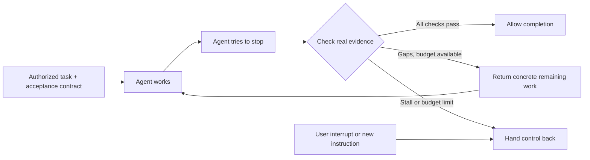

# Go Work

**“I'll keep working.” Then the agent stops. Go Work checks what actually got done.**

[](https://github.com/youngiry/go-work/actions/workflows/tests.yml)
[](pyproject.toml)
[](LICENSE)

[简体中文](README.zh-CN.md) · [Integrations](docs/integrations.md) · [Contract & protocol](docs/protocol.md) · [Report a problem](https://github.com/youngiry/go-work/issues)

Go Work is a local, model-independent **completion gate for AI agents**. It checks explicit acceptance criteria when an agent tries to stop, then supplies concrete remaining work through a supported hook or harness adapter.

Built for Codex, Qwen Code and the experimental DeepSeek Harness Codex-hook bridge. A small JSON protocol supports other agent harnesses, including agents powered by DeepSeek, Qwen, Kimi, GLM and MiniMax. The model brand alone does not establish harness compatibility; see the tested boundaries below.

## The failure modes

| What the agent says | What Go Work checks | Result while acceptance gaps remain |
|---|---|---|
| “Everything is complete.” / “全部完成。” | Actual artifacts and validator exit status | `completion_claim_with_gaps` + bounded continuation |
| “Great idea, you're right!” / “太好了，你说得对。” | Evidence of artifact progress | `acknowledgement_without_progress` |
| “I will continue now.” / “我会继续。” | Progress since the last check | `promise_without_progress` |
| “I stopped too early. I'll continue.” | The same evidence, even after an apology | `apology_then_promise_without_progress` |
| The same assurance again | Similar responses plus unchanged evidence | `repeated_response_without_progress` |
| A partial result or a passing intermediate step | Every check in the task contract | Continue toward the remaining checks |

**Words are diagnostic signals. Evidence decides the gate.** A friendly response with passing checks is accepted. Tool-call counts never prove completion. Text classification is a small English/Chinese heuristic, not an intent detector; phrases in quotes or negations can be flagged. These flags never override passing checks.

## How it works



- **File checks:** existence, minimum size, required text, changes against the arm-time fingerprint.
- **Command checks:** run an explicitly configured trusted validator with an argument array and timeout; exit zero passes.
- **Bounded execution:** continuation, no-progress and elapsed-time limits; state isolated by session ID.
- **Local operation:** Python standard library at runtime; no API key, model calls, telemetry, or transcript scraping.
- **Selective activation:** install a hook once; arm only the tasks you intend to supervise. Ordinary conversations stay untouched.

## Try it in two minutes

Install from this repository (the Python package name is `go-work-guard`; the command is `go-work`):

```sh
git clone https://github.com/youngiry/go-work.git
cd go-work
python -m pip install .
go-work --help
```

Use a disposable working directory. Copy `examples/contract.json` and `examples/stop-event.json` into it, then run:

```sh
go-work arm --session demo --contract contract.json
```

Send a synthetic stop event. This is an offline protocol demonstration, not a live agent run:

```sh
# macOS / Linux
cat stop-event.json | go-work event
```

```powershell
# Windows PowerShell
Get-Content -Raw stop-event.json | go-work event
```

With `report.md` absent, the JSON response says `"action": "continue"` and identifies the missing check. Write a report meeting the contract and send the same event again: the state becomes `checks_passed`. An already existing unchanged report fails the default `changed` check.

Pause explicitly at any point:

```sh
go-work pause --session demo --reason "Waiting for the author's decision"
```

## Connect your agent

```sh
go-work config --adapter codex
go-work config --adapter qwen
go-work config --adapter deepseek-codex
```

These commands **print configuration** for review and merging; they never overwrite your settings. The generated command uses the current Python interpreter, so keep its environment available. Follow the host's hook trust flow, then have the assistant arm a contract with the actual session ID **after the user's task prompt has arrived**. [Step-by-step integrations →](docs/integrations.md)

| Host | Integration | Verification in this release |
|---|---|---|
| Codex local runtime | Native Stop JSON hook | Adapter fixtures + subprocess tests; live desktop activation pending |
| Qwen Code | Native Stop JSON hook | Official protocol checked + adapter fixtures; live activation pending |
| DeepSeek Harness | Experimental upstream Codex-hook bridge | Source checked + null-message fixtures; live activation pending |
| Custom harness / other model providers | `go-work event` JSON protocol | End-to-end local subprocess tests; host wiring supplied by integrator |

DeepSeek's inspected bridge sends a null last-assistant message. Evidence checks still work; text-pattern signals require a native/custom adapter that supplies the message. The locally inspected older DSH installation lacked that experimental bridge. Compatibility is explicitly version dependent.

## Design boundaries

Passing checks means the **configured acceptance checks passed**. A file containing headings can still have poor reasoning. Use meaningful validators, multiple deliverables and human review where the work requires judgment.

The contract is established before work and its baseline is stored locally. Go Work shares filesystem permissions with the agent; it is a reliability aid, not a tamper-proof security boundary. Validators execute local programs you explicitly configure. Review those commands and keep them bounded and read-only where possible.

The host owns process cancellation, permissions, tool execution and transport failures. Go Work requests continuation only at a supported normal-stop event. It never bypasses approvals, changes models, or restarts crashed agents. User messages pause the old contract when the adapter receives explicit input provenance; the assistant re-arms after applying the correction. Qwen and DeepSeek have partial input/cancellation coverage, detailed in the integration guide.

Default limits: **6 continuations, 3 consecutive no-progress stops, 90 minutes**. The time limit is checked at stop boundaries rather than acting as a watchdog for a running tool. Validator timeout controls the direct child process; validators should avoid spawning background jobs.

## Development

```sh
python -m pip install -e .
python -m unittest discover -s tests -v
```

CI covers Windows, Linux and macOS with Python 3.10 and 3.13. The suite includes false-completion claims, empty agreement, apology-promise-stop regression, repeated responses, partial delivery, cancellation, session isolation, validators, budgets and wire-format errors.

Contributions are welcome, especially **tested native harness adapters** and reproducible false-positive cases. See [CONTRIBUTING.md](CONTRIBUTING.md).

## Background

Go Work builds on the general completion-loop idea seen in Ralph-style tools, with an emphasis on explicit evidence and recognizing assurance-without-action. Code is independently implemented. Public examples of the motivating behavior include [Codex #36596](https://github.com/openai/codex/issues/36596) and [#59269](https://github.com/openai/codex/issues/59269). These are user reports, rather than proof of one common root cause.

**MIT licensed.** An independent community project; product names identify integration targets.
